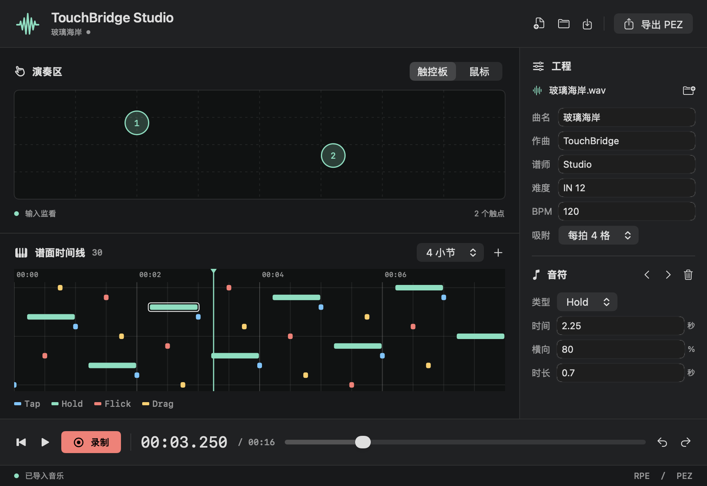

# TouchBridge Studio

跟着音乐，把 Mac 触控板当作多指打谱台。用指尖录下 Tap、Hold、Flick、Drag，在时间线上修正，再导出带音乐的 RPE 谱包。这个分支是用 Swift 重写的原生 Mac 应用。



## 在 Mac 上运行

需要 macOS 14 或更新版本；从源码构建需要带 Swift 5.10 或更新版本的 Xcode 或 Command Line Tools。在仓库根目录运行：

```sh
./scripts/build-app.sh
open "dist/TouchBridge Studio.app"
```

运行时不用安装 Python、启动服务器或打开浏览器。构建脚本生成供本机使用的应用，未做 Developer ID 签名或公证。

**先试一份现成的谱：** 运行 `./scripts/smoke.sh` 会用合成音生成八秒钟的 *Pulse Study*，连同可编辑的 `.tbstudio` 和导出的 `.pez` 放在 `dist/Examples/`。在应用内按 **⌘O**，打开生成的工程；按空格播放，点一个音符查看它的类型、时间和横向位置。

## 录一段自己的音乐

1. **⌘I** 导入可由 macOS 解码的本地音乐。设置 BPM 和每拍细分，或关闭吸附以保留原始时间。
2. 指针停在演奏区，抬起手指再触碰。画面上的触点说明窗口收到了输入。按 **R** 从当前播放头开始录制。短按、长按、快速甩动、缓慢移动分别产生四类音符。用鼠标时，在演奏区右上角切换输入方式。
3. 再按 **R** 停止。点时间线定位，选中音符后可调整类型、起点、位置和 Hold 时长。**Delete** 删除，**⌘Z** 撤回一次编辑或整段录制。
4. **⌘S** 保存工程。工程包内含原音频，移动整个包即可换位置继续编辑。**⌘E** 导出供下游播放器使用的 PEZ 谱包。

## 实现边界

- **输入：** 只在演奏区使用 AppKit 间接触摸事件，不读取全局触点，不调用私有框架。系统手势可能先取得某些触点；失焦会结束当前录制，未抬起的手指不会生成音符。按 R 开录可以让指针一直停在演奏区。
- **计时：** AVFoundation 安排音频开始时间，录制用事件时间戳换算歌曲时间。界面刷新只移动播放头，不参与音符计时。这不能自动消除蓝牙耳机等设备的输出延迟。
- **谱面：** 当前是单 BPM、单判定线。Drag 表示一个 Drag 音符；不把连续轨迹展开成一串音符。没有变速、判定线动画编辑或已有 PEZ 导入。
- **兼容性：** 自动化覆盖模型、文件格式和录制会话。真机多指手感、系统手势抢占、以及实机播放器导入需要分别验收；不能凭 ZIP 或 JSON 检查断言某款游戏可直接播放。

## 开发与验证

`Sources/StudioCore` 定义手势、量化、工程格式和 PEZ 写入；`Sources/StudioApp` 负责输入、音频、撤销和窗口。两层之间使用乐曲秒数和归一化横坐标，不依赖 UI 刷新频率或 OSC 传输。

- 完整 Xcode 环境：运行 `swift test`。
- Mac 本机冒烟验证：运行 `./scripts/smoke.sh`。它实际载入音轨，向录制会话注入带时间戳的触点，检查取消与撤销，保存和重新打开工程，最后生成并校验 PEZ。需要可用的音频输出设备。

## 来源与许可

原始理念来自 [MiGuo2787/TouchBridge-RPE](https://github.com/MiGuo2787/TouchBridge-RPE)。组织 fork 保留上游历史与 [MIT 许可](LICENSE)。新版从项目说明出发，独立实现了采集、计时、手势、文件格式写入和界面；重写过程中使用了 AI 辅助开发。
